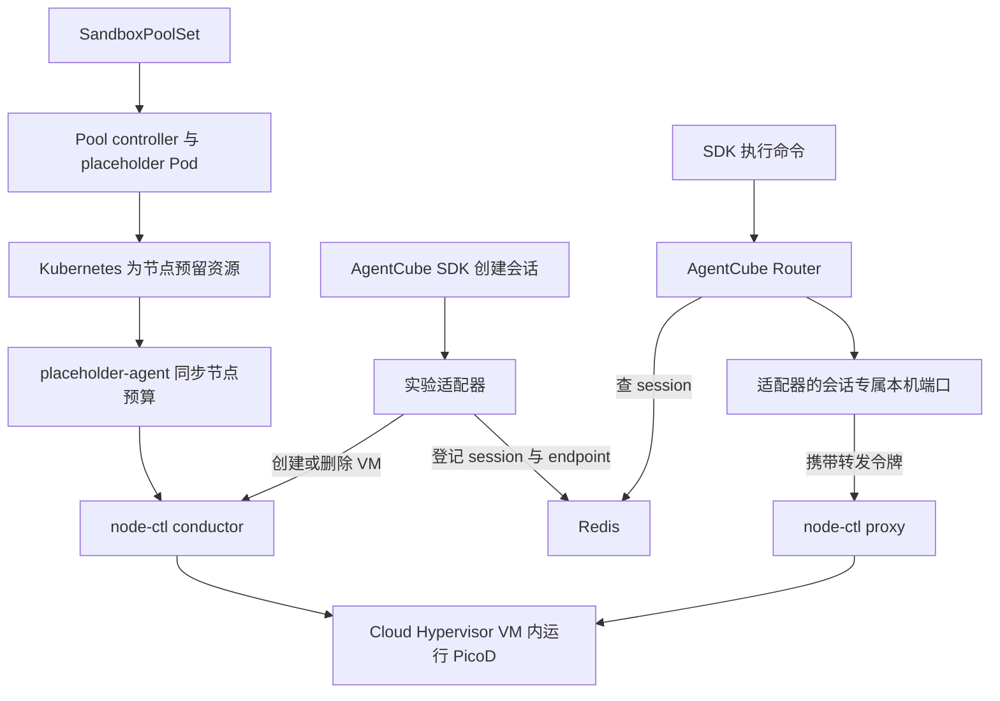

# AgentCube 使用 Kuasar Sandbox Pool 的单节点实验

2026-11-12，在本地 ARM64 Linux 节点上，AgentCube Python SDK 创建了一个会话。Kuasar 在 Kubernetes 已预留的 Pool 内启动 VM，AgentCube Router 将命令送到 VM 内的 PicoD。SDK 执行 `echo hello` 成功，删除会话后节点的 reservation 恢复为空。

**集成改动集中在会话创建与删除。** 实验用本目录的 Go 程序实现了 CodeInterpreter 所需的两个 WorkloadManager 接口。它调用现成的 node-ctl conductor 创建和回收 VM，并把可访问的 PicoD 地址写入 Router 已使用的 Redis。SDK、Router 与 PicoD 使用 AgentCube 原有代码。适配器仅实现一个模板和一个并发会话，正式 WorkloadManager 尚未集成此后端。

## 一个请求经过哪里



- **谁选节点？** 实验只给一个 worker 打 Pool 标签。Kubernetes 管理 placeholder Pod 和这块容量。申请会话时，适配器直接调用这个已知节点上的 conductor，无须再部署 Kuasar 的集群级选址服务。多节点情况下，创建方仍要能找到有余量的 Pool。
- **为什么还要 conductor？** Pool 提供节点预算。运行 `node-ctl conductor serve` 的进程接收创建请求、准入 reservation 并驱动 VM 生命周期。仅放置 node-ctl 二进制没有启动这些服务。
- **谁执行命令？** Guest 就是新启动的 VM；PicoD 是 VM 内运行的 AgentCube 服务。node-ctl proxy 负责把流量送进去。适配器为每个会话生成一个固定目标的 loopback endpoint，注入节点转发令牌，保留 Router 发给 PicoD 的鉴权头。因此本实验要求 Router 与适配器共享网络命名空间。

## 实测

验收脚本先读取真实 node-ctl Unix socket，再通过 SDK 创建会话。下表来自同一次运行，SDK 返回的 session ID 与节点报告的 sandbox ID 均为 `d6af99fa-38b2-410d-8a29-996d17cdf756`。

| 时刻 | 观察 |
| --- | --- |
| 创建前 | 节点 reservation 列表为空，SandboxPool 为 Ready |
| 创建后 | 唯一 reservation 的 capacity 为 402653184 字节（384 MiB）、1000m CPU，状态为 settled，connected 为 true |
| 执行时 | SDK 请求 VM 中的 `/bin/sh -c 'echo hello'`，stdout 为 `hello\n`，stderr 为空，exit code 为 0 |
| SDK 删除后 | 节点列表恢复为空；用原 ID 执行命令，SDK 收到 SessionNotFoundError |

另两次独立 SDK 会话也成功执行并释放。补测中，未知模板返回 404，非法 TTL 返回 400，已有活动会话时第二个申请返回 409；指定 15 秒 TTL 后，无须 SDK 主动删除，节点 reservation 也被回收。Go 侧运行 `go test ./example/kuasar-pool ./pkg/router ./pkg/store` 通过。384 MiB 是预留容量；该时刻节点报告的 current_rss 为 29683712 字节。没有测量性能或验证 CPU 限流。

## 本地环境与调通记录

- Apple M1 Max 上用 QEMU 11.1.3 TCG 启动 Debian 13 ARM64 worker，4 vCPU、4500 MiB，内核 6.12.116+deb13-arm64。外层 QEMU 启用 virtualization，worker 内可用 /dev/kvm。K3s v1.35.5+k3s1 控制面和 Redis 7 各运行在一个本地 Docker 容器中。实验用的 Pool、conductor、proxy、Router 和 VM 均在同一个 worker 上。
- Pool 源码版本 e440730，Kuasar 发布包 release-v0.1.13，包含 sandboxer v0.1.14、Cloud Hypervisor v51.1.0 和 connector v0.1.8。复现需要单独准备 Pool 的 CRD、controller、placeholder-agent 和 containerd shim。
- worker 注册 containerd runtime handler `placeholder`，RuntimeClass 的 overhead 为 10m CPU、16 MiB。K3s 自带的 containerd v2.2.3-k3s1 调用 shim 遇到 unsupported protocol；在实验 worker 替换为 containerd v2.3.1 并补齐本地 pause 镜像后，placeholder Pod 进入 Running。
- SandboxPoolSet 通过标签 `sandbox-pool.io/pool-node=true` 选择 worker，预算为 3 CPU、1800 MiB。placeholder-agent 从基础配置和 Pool 预算生成 /run/node-ctl/conductor.yaml。确认文件已生成、状态目录及运行目录已创建后，再启动 conductor。节点汇总查询的 allocatable_pool.cpu_milli 曾显示 0，本次 CPU 记录取自单个 reservation。
- 节点使用 TAP vswitch，配置 8 个端口时端口都被保留，调整为 64 个后可分配给 VM。node-ctl proxy 开启 auth enforce。模板由带 /bin/sh 的 Alpine 根文件系统和静态编译的 ARM64 PicoD 制成，用 flatten-ctl export 打包，配合本地 file location 及 192 MiB ext4 overlay。VM 启动命令为 `/usr/local/bin/picod -workspace /workspace`。

## 在已准备好的节点上重跑

先确认目标 Pool 为 Ready、placeholder Pod 为 Running，节点 resource list 为空。使用本实验专用节点，验收会创建并删除真实 VM。编译节点二进制的命令在 AgentCube 仓库根目录运行。

```sh
CGO_ENABLED=0 GOOS=linux GOARCH=arm64 go build -o adapter ./example/kuasar-pool
CGO_ENABLED=0 GOOS=linux GOARCH=arm64 go build -o router ./cmd/router
CGO_ENABLED=0 GOOS=linux GOARCH=arm64 go build -o picod ./cmd/picod
```

节点上运行下列两个 node-ctl 服务。conductor 使用 Pool 生成的配置；proxy 配置须指向同一 control.sock。实验分别监听 127.0.0.1 的 18083、18084 端口。

```sh
node-ctl conductor serve --config /run/node-ctl/conductor.yaml
# 在另一个终端运行
node-ctl proxy serve --config /opt/pool-lab/proxy.yaml
```

启动 Router 时接入实验 Redis，配置可以在 kuasar-lab 中管理身份 Secret 的 Kubernetes 服务账号，以及供 PicoD 验签的密钥对。适配器使用同一 Redis，按下表提供环境变量后运行 ./adapter。它监听 127.0.0.1:18090。

| 变量 | 实验取值或来源 |
| --- | --- |
| CONDUCTOR_URL、NODE_PROXY_URL | http://127.0.0.1:18083 和 http://127.0.0.1:18084 |
| KUASAR_API_KEY | 使用节点已注册的 manifest key 派生的实验 API key |
| KUASAR_TEMPLATE | 指向本节点 PicoD 根文件系统的 bare-img 模板 ID |
| PICOD_PUBLIC_KEY_FILE | 与 Router 签名私钥配对的公钥文件 |
| REDIS_ADDR、REDIS_PASSWORD_REQUIRED | 与 Router 共用的实验 Redis 地址；本地无密码实例设为 false |

客户端安装本仓 SDK，将两个 URL 指向 Router 和适配器。本地实验分别映射到 18945、19090 端口。--ssh 指的是能读取目标节点资源 socket 的 SSH 别名；直接在节点执行时可省略。

```sh
python3 -m venv /tmp/agentcube-pool-sdk
/tmp/agentcube-pool-sdk/bin/pip install ./sdk-python
ROUTER_URL=http://127.0.0.1:18945 WORKLOAD_MANAGER_URL=http://127.0.0.1:19090 \
  /tmp/agentcube-pool-sdk/bin/python example/kuasar-pool/verify.py --ssh pool-vm
```

## 可以据此做什么决定

如果目标是让 AgentCube 使用 Kuasar Pool，这条路径值得接入已有 WorkloadManager。保留当前 SDK 和 PicoD 协议，在创建会话时选择一个 Ready Pool，向其 conductor 申请 VM，将可路由的 endpoint 登记在已有 session store，删除时回到同一节点释放资源。Agent-sandbox 可以继续承载现有 Pod 路径，本实验只验证了 Kuasar 后端。

推进到多节点前，需要解决 Router 跨节点寻址和令牌传递、适配器重启后恢复会话与清理失败重试。本实验的活动表、TTL 计时器和转发端口都在内存中。使用的是 Cloud Hypervisor；更换 Firecracker、比较冷启动耗时、验证相同预算下的并发上限，都需要独立实验。
